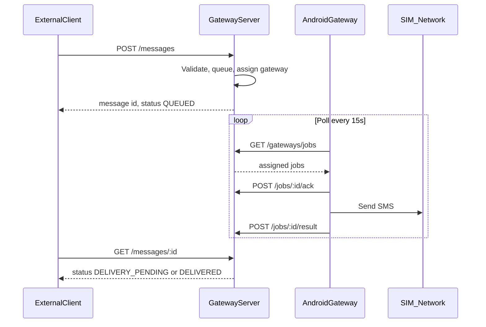
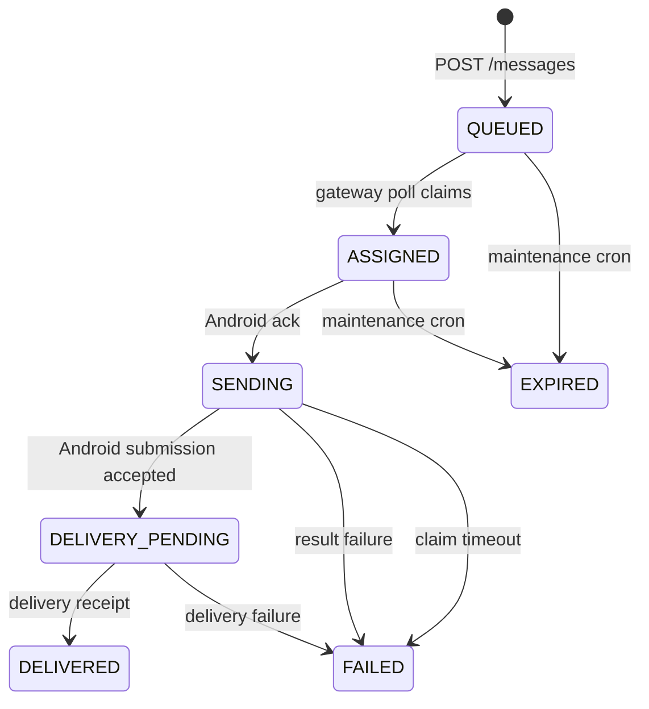
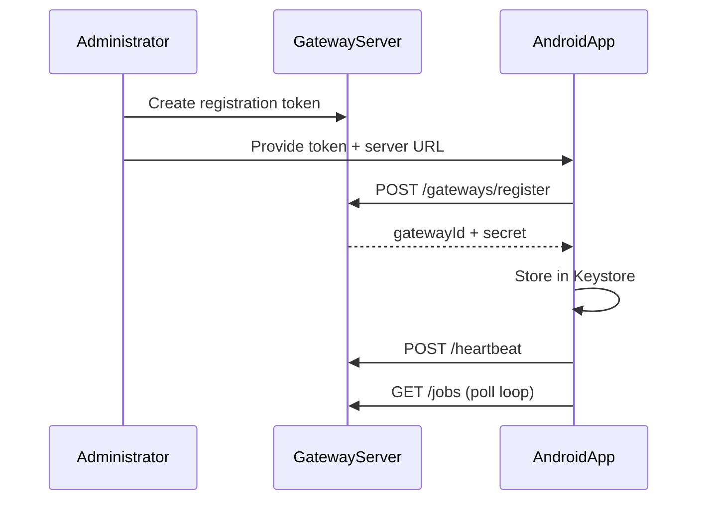

# Architecture

## Overview

The SMS Gateway separates message orchestration (server) from message transport (Android + SIM). External applications never communicate directly with Android devices.

## Message Flow

## Message Lifecycle

## Duplicate Delivery Prevention

Critical scenario: Android sends SMS successfully but network fails before reporting to server.

1. **Ack before send:** Job moves to `SENDING` before SMS attempt
2. **Local persistence:** Android stores result in Room before/at send
3. **Replay on restart:** Unreported results are POSTed before polling new jobs
4. **No auto re-send:** Stuck `SENDING` jobs become `FAILED` with `DELIVERY_UNCERTAIN` — never re-queued automatically
5. **Idempotency:** Client `Idempotency-Key` prevents duplicate message creation

## Registration Flow

## Multi-Gateway

Each Android phone is a gateway with its own credential. The server tracks:

- Gateway ID (device identity, not phone number)
- Status (ONLINE/OFFLINE/PAUSED/REVOKED)
- Last heartbeat
- Active job count

Simple selection: first online gateway with lowest active job count.

## Server Design (Vercel-Compatible)

- Stateless HTTP handlers (Hono)
- PostgreSQL for all persistent state
- Database-backed job queue (no in-memory queues)
- Postgres-backed rate limiting
- Vercel Cron for maintenance (expire, stuck jobs, offline detection)
- Same code runs on VPS via `node dist/server.js`

## Android Design

- Foreground Service for reliable polling
- HTTPS outbound only (phone initiates connections)
- WorkManager + BootReceiver for recovery
- FakeSmsSender for dev/test builds

## Boundaries

| Responsibility | Owner |
|----------------|-------|
| OTP generation | External app |
| OTP verification | External app |
| Message queuing | Gateway Server |
| SMS transport | Android Gateway |
| Phone number validation | Gateway Server |
| Credential management | Gateway Server + Android Keystore |
